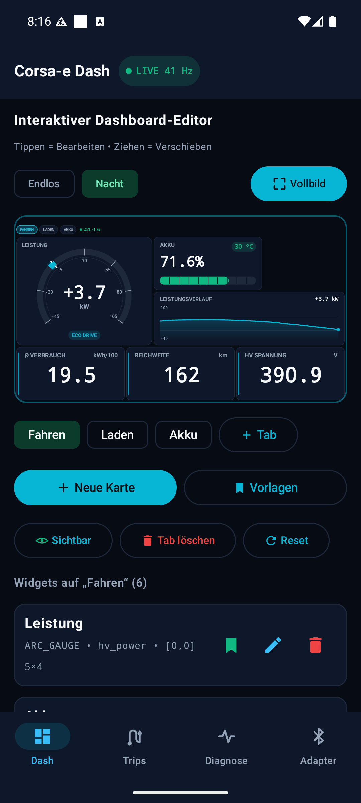
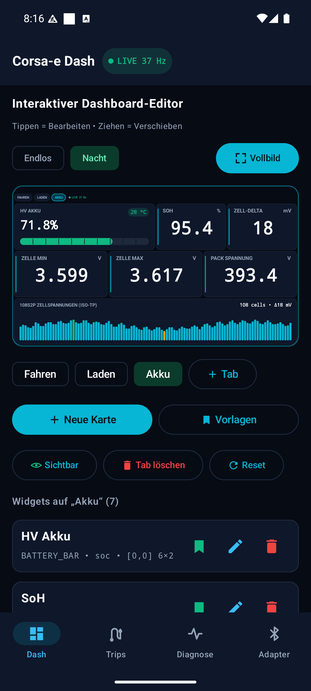
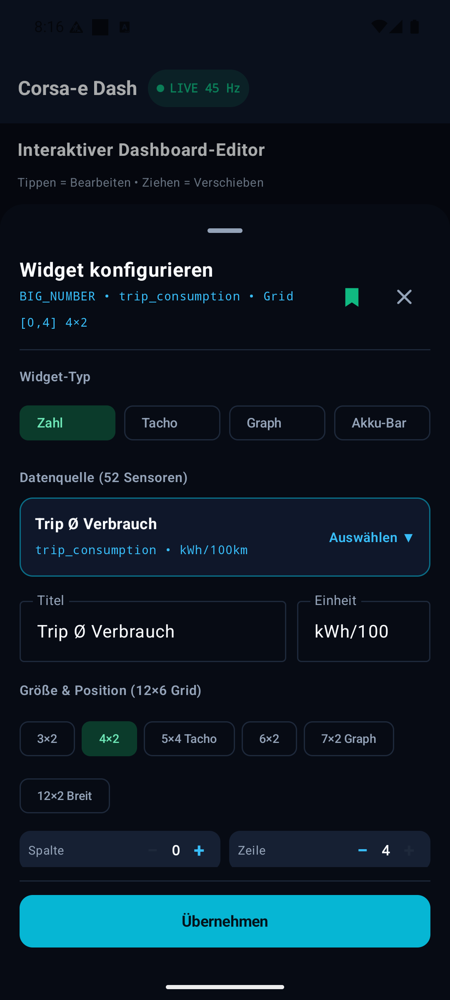
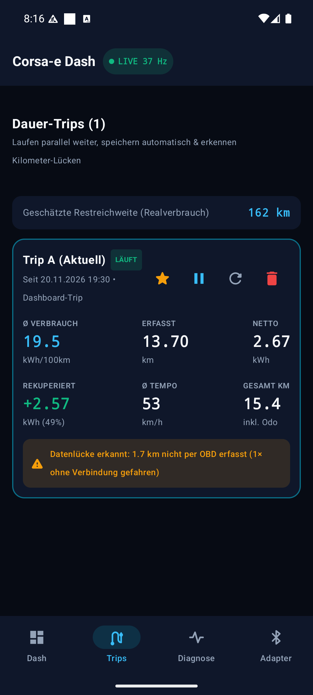
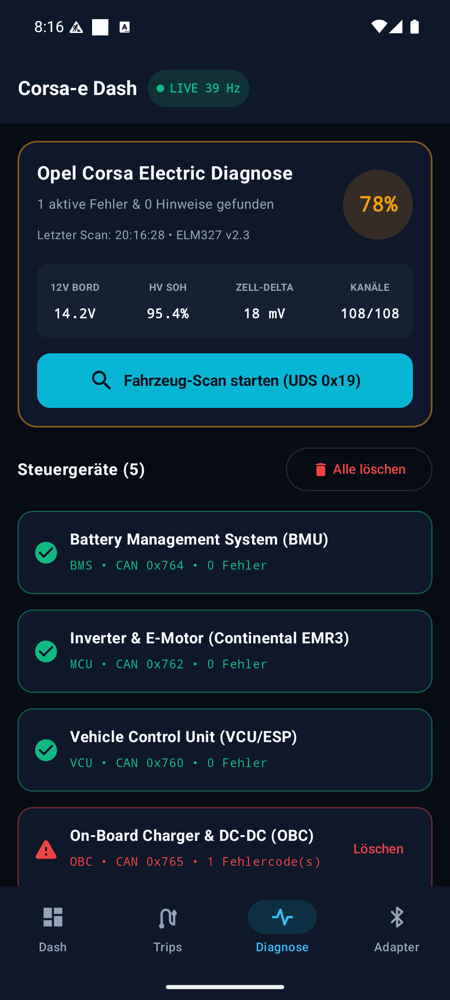
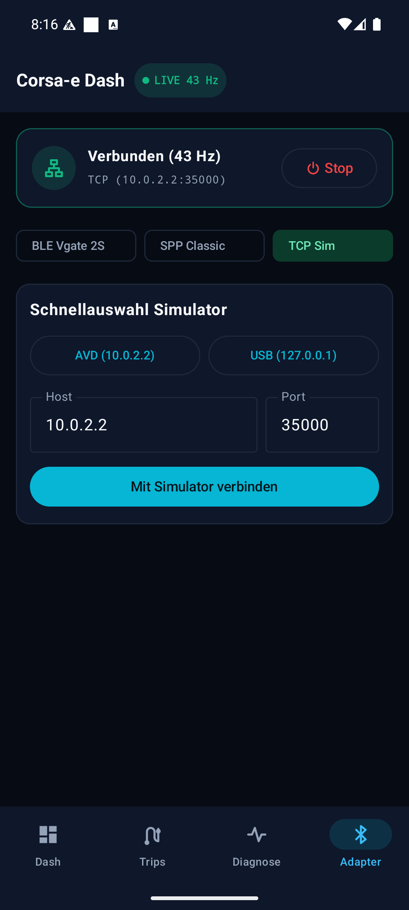

# Corsa-e Dash — Android Auto OBD2 Telemetry Dashboard

<p align="center">
  <strong>Native Android &amp; Android Auto OBD2 Dashboard for the Opel Corsa Electric (Stellantis e-CMP, 50 kWh 108s2p)</strong><br/>
  Built with Kotlin, Jetpack Compose, Android Auto Car App Library (<code>NavigationTemplate</code> + hardware-accelerated <code>Canvas</code>), and a custom ELM327 v2.3 / UDS (ISO 14229) / ISO-TP engine — designed for <strong>sideloading without a Google Play Developer account</strong>.
</p>

<p align="center">
  
  
  
  
</p>

---

## Screenshots (AVD + Live ELM327 Simulator)

| Driving Dashboard (`Fahren`) | 108s2p Battery Cell Spectrum (`Akku`) | Unified Widget Configurator (52 Sensors) |
| :---: | :---: | :---: |
|  |  |  |

| Concurrent Trip Tracker & Gap Detection | Multi-ECU UDS `0x19` Diagnostics | BLE / SPP / TCP Adapter Connection |
| :---: | :---: | :---: |
|  |  |  |

---

## Highlights & Features

- **Full-Screen Custom Android Auto Canvas:** Uses `androidx.car.app.category.NAVIGATION` + `NavigationTemplate` with `SurfaceCallback` to render a custom 12×6 virtual grid inside `stableArea` (tested at Corsa-e reference `1280×720 @ 160 dpi`).
- **Modular Widget Engine:**
  - `ArcGaugeWidget` — 250° EV powermeter with regen/drive zones, ticks, glow arc, needle, and auto-scaling.
  - `BatteryBarWidget` — 10-segment SoC bar with live battery temperature badge.
  - `SparklineWidget` — smooth cubic time-series graph + dedicated **108s2p cell voltage bar spectrum** with min/max highlights.
  - `BigNumberWidget` — crisp high-contrast numeric telemetry tiles.
- **Interactive Dashboard Builder (Phone Companion App):**
  - Tap to configure, drag-and-drop to reposition on the 12×6 grid, and horizontal fullscreen preview (`16:9` fit-height).
  - Multiple customizable tabs (`Fahren`, `Laden`, `Akku`, plus custom tabs), optional **Endless Scroll** ribbon in Android Auto, and **My Dashboards / My Cards** template library.
  - Instant live hot-reload from Phone Companion App to Android Auto.
- **52 Telemetry Channels (39 UDS PIDs + 13 Computed EV Metrics):**
  - Covers 5 Stellantis e-CMP ECUs (`BMS 0x764`, `MCU/Inverter 0x762`, `VCU 0x760`, `OBC/DC-DC 0x765`, `HVAC 0x767`): HV BMS/Inverter/Motor kW, torque, RPM, SoC, SoH, 108s2p cell voltages (ISO-TP multi-frame), battery/inverter/motor/coolant temperatures, 12V aux voltage/current, AC/DC charging power, HVAC/PTC heater draw, drivetrain efficiency, and power losses.
  - Single Source of Truth catalog in [`docs/corsa_e_pids.json`](docs/corsa_e_pids.json) (shared by both the Android app and the Python ELM327 simulator).
- **High-Throughput ELM327 v2.3 Engine:**
  - Fast-Wake (`\r` / `ATI` before `ATZ`), Corsa-e CAN init (`ATE0`, `ATL0`, `ATS0`, `ATSP6`, `ATCAF1`, `ATCFC1`, `ATAT2`, `ATST0A`), ECU header grouping, expected-frame-count hints, and tiered polling (`FAST` / `MEDIUM` / `SLOW`).
  - Dual-mode Bluetooth support for **Vgate iCar Pro 2S** (**BLE GATT** `18F0 / 2AF0 / 2AF1` + MTU negotiation & **Classic SPP/RFCOMM**), plus **TCP** transport for local simulator testing.
- **Always-Running Concurrent Trips:** Unlimited parallel trips with automatic persistence, real consumption (`kWh/100 km`), recuperation %, estimated real-world range, and automatic **odometer data-gap detection**.
- **Multi-ECU UDS Diagnostics:** Vehicle Health Score (0–100%), UDS `0x19 02 FF` DTC scanning & `0x14 FF FF FF` clearing across ECUs, plus hidden Developer Tools (Raw-OBD-Log & interactive AT/UDS console).
- **12V Battery Protection & Zero-Blank UI:** Immediately displays cached values on startup until live frames arrive; stops polling and closes the `connectedDevice` foreground service on Android Auto disconnect (`Session.onDestroy`) or car Bluetooth disconnect (`ACTION_ACL_DISCONNECTED`).

---

## ⚠️ Important Notice on PIDs (`docs/corsa_e_pids.json`)

All starter UDS DIDs, CAN headers, and scaling formulas in [`docs/corsa_e_pids.json`](docs/corsa_e_pids.json) are explicitly marked `"verified": false` so nothing is silently assumed or hardcoded in Kotlin. Use the built-in **Diagnose → Entwickler-Tools (Raw-OBD-Log & AT/UDS-Konsole)** in your vehicle to verify and calibrate each PID for your exact Corsa-e / e-CMP firmware version, then flip `"verified": true`.

---

## Installation (Sideloading for Android Auto)

Because Android Auto hides apps that were not installed via Google Play unless **Unknown Sources** is enabled and the installer package is set to `com.android.vending`, install the release APK from the [Releases](../../releases) page via ADB:

```bash
adb install -r -i "com.android.vending" app-release.apk
```

Then on your phone:
1. Open **Android Auto Settings** → tap **Version** 10 times to enable **Developer Mode**.
2. Open the top-right `⋮` menu → **Developer Settings** → enable **Unknown Sources** (*Unbekannte Quellen*).
3. Open **Corsa-e Dash**, connect your **Vgate iCar Pro 2S** (BLE or SPP) in the **Adapter** tab, and launch **Corsa-e Dash** in Android Auto.

---

## Local Development & Testing (macOS / Linux)

No real car is needed for development or UI testing. The repository includes a pure Python 3 (`asyncio`, zero external dependencies) ELM327 v2.3 + UDS + ISO-TP multi-frame simulator driven directly by `docs/corsa_e_pids.json`.

### 1. Start the Python ELM327 Simulator

```bash
python3 tools/corsa_elm_sim.py --mode drive --port 35000
```

Available modes: `drive`, `dc-charge`, `isotp-multiframe`, `chaos` (simulates timeouts & reconnects).

### 2. Build & Run Unit Tests

```bash
./gradlew assembleDebug testDebugUnitTest
```

### 3. Test on AVD + Android Auto Desktop Head Unit (DHU)

- In the app's **Adapter** tab, select **TCP Sim** → `AVD (10.0.2.2):35000` (or `USB (127.0.0.1):35000` with `adb reverse tcp:35000 tcp:35000`).
- Launch DHU with the Corsa-e display profile (`1280×720`, `160 dpi`, `60 fps`):

```bash
adb forward tcp:5277 tcp:5277
"$ANDROID_HOME/extras/google/auto/desktop-head-unit" -c tools/headunit_corsa.ini
```

---

## Project Architecture

```text
elmdash/
├── app/                     # Android application, CarAppService, ForegroundService & Jetpack Compose Phone UI
├── core/                    # ELM327 session, BLE/SPP/TCP transports, ISO-TP assembler, UDS & DTC parser, TripTracker
├── ui/                      # Canvas SurfaceRenderer, 12x6 GridLayoutEngine, DashboardTheme & modular widgets
├── docs/
│   ├── corsa_e_pids.json    # Single Source of Truth PID & ECU catalog (39 UDS PIDs)
│   └── screenshots/         # AVD showcase screenshots
└── tools/
    ├── corsa_elm_sim.py     # Pure Python 3 ELM327 + UDS + ISO-TP multi-frame simulator
    ├── headunit_corsa.ini   # Android Auto DHU config (1280x720 @ 160 dpi)
    └── dev_up.sh            # Local macOS dev launcher helper
```

---

## License

MIT License — feel free to fork, adapt for other Stellantis e-CMP vehicles (e-208, e-2008, Mokka-e, DS 3 E-Tense), and contribute verified PIDs!
